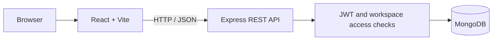

<div align="center">

# TaskFlow

**Plan clearly. Collaborate effortlessly. Deliver consistently.**

A full-stack project and task management application with workspaces, role-based access, Kanban workflows, and team activity tracking.


</div>

## Overview

TaskFlow helps teams organize projects, assign work, monitor progress, and discuss tasks in one shared workspace. It is built with a React frontend, an Express REST API, and MongoDB persistence.

## Features

- **Authentication:** Registration, login, bcrypt password hashing, and JWT-protected API routes.
- **Workspaces:** Create and switch workspaces; manage members with owner, admin, and member roles.
- **Projects:** Create, edit, archive, restore, and track project progress.
- **Tasks:** Create and manage tasks with assignees, priorities, statuses, due dates, and tags.
- **Kanban board:** Move tasks between To do, In progress, In review, and Done.
- **Collaboration:** Task comments, workspace invitations, and activity history.
- **Dashboard:** Workspace-level task metrics, project progress, workload, and upcoming deadlines.
- **Search and filtering:** Find tasks by keyword, status, priority, project, assignee, and due date.
- **Responsive UI:** Layouts for desktop, tablet, and mobile screens.

## Tech stack

| Layer | Technologies |
|---|---|
| Frontend | React 18, Vite, React Router, Lucide React |
| Backend | Node.js, Express.js |
| Database | MongoDB, Mongoose |
| Authentication | JWT, bcryptjs |
| API security | Helmet, CORS, express-rate-limit |
| Local deployment | Docker, Docker Compose |
| Hosting target | Vercel + MongoDB Atlas |

## Architecture



## Run locally

**Requirements:** Node.js 20+, npm, and MongoDB (local instance or MongoDB Atlas).

```bash
git clone https://github.com/<your-username>/<your-repository>.git
cd <your-repository>
npm install
npm run install:all
```

Create `backend/.env` using `backend/.env.example` and configure your database connection and JWT secret. Then start the application:

```bash
npm run dev
```

Default local URLs:

- Frontend: `http://localhost:5173`
- API health: `http://localhost:5000/api/health`

For Windows, the repository also includes `scripts/setup-windows.ps1` to assist with initial setup.

## Environment variables

Backend (`backend/.env`):

```env
NODE_ENV=development
PORT=5000
MONGODB_URI=your_mongodb_connection_string
JWT_SECRET=your_unique_secret_at_least_32_characters
JWT_EXPIRES_IN=7d
CLIENT_ORIGIN=http://localhost:5173
```

Frontend (`frontend/.env`), when frontend and API are hosted separately:

```env
VITE_API_URL=https://your-api-domain/api
```

Never commit `.env` files or expose database credentials and JWT secrets. `VITE_` variables are public in the browser bundle and must not contain secrets.

## Deployment

The intended hosting setup is **Vercel for the frontend and API, with MongoDB Atlas for data storage**. The Express API must be configured for Vercel's serverless runtime before deployment. Deployment is not claimed as live until the hosted application and its core workflows have been tested.

## Current limitations

- Workspace invitation links are generated for manual sharing; email delivery is not configured.
- Password reset and email verification are not implemented.
- File attachments and real-time WebSocket updates are not implemented.
- Browser authentication currently uses localStorage; review the security implications before production use.
- No automated browser end-to-end test suite is included.

## Author

**Kavyashree K.**  
Integrated M.Tech, Software Engineering  
[GitHub](https://github.com/Kavyashree784) · [LinkedIn](https://www.linkedin.com/in/kavyashree-k-482a63258)
